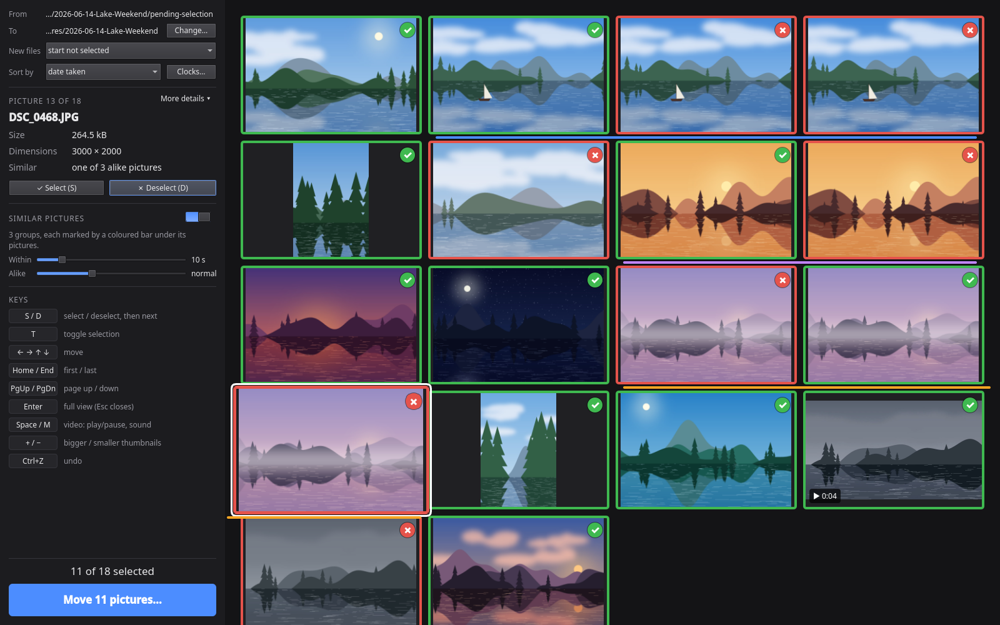

# picsel

Pick which pictures (and videos) of a folder to keep, quickly, with the keyboard.



Typical use: dump an event's photos into `Some-Event/pending-selection/`,
right-click any picture in the file manager → **Open with picsel**, mark the
keepers (or the rejects), then press **Move** to move the selected ones into the
gallery folder (by default the parent). Delete `pending-selection/` yourself
when you are done.

## Using it

- Opening a picture opens its whole folder, with that picture highlighted.
  Opening a folder's `picsel.db` opens that folder. Running `picsel` with no
  arguments asks for a folder; `picsel DIR` works too.
- The first time, picsel asks for the destination folder and whether pictures
  start as selected or not selected. It then keeps `picsel.db` in the folder.
  Every change is saved immediately, so you can close picsel (or it can crash)
  and continue later.
- If a folder was copied, moved or renamed since it was set up, picsel asks
  for the destination again (the selection is kept). A `picsel.db` that is
  not picsel's, or is damaged, is never modified: picsel explains and stops.
- Files added, deleted or renamed in the folder while picsel runs are picked up
  automatically. New files get the folder's default state.

| Key | Action |
|---|---|
| `S` / `D` | select / deselect, then go to the next picture |
| `T` | toggle the selection without moving |
| Arrows | move (left/right wrap across rows) |
| Home / End, PgUp / PgDn | first / last, page up / down |
| Enter or double-click | full view (Esc or Enter closes) |
| Space / `M` | in the full view, play/pause a video / toggle its sound |
| `+` / `-` | bigger / smaller thumbnails (2–6 columns) |
| Ctrl+Z | undo selection changes |

The **Move** button checks every selected file first. If a folder, link or other
non-regular file has the same name in the destination, nothing is moved. For
existing pictures with the same name you choose overwrite, keep both (adds
`-1`, `-2`… to the name) or skip. Moves within one filesystem are instant
renames; across filesystems files are copied, synced to disk, and only then
removed from the source.

Pictures are sorted by date taken by default; the side panel switches to
sorting by name. **Sort by date taken** uses EXIF dates (videos use their
creation time); files without one go last, by name. If a camera's clock was
off, fix it once under **Camera clocks…**; corrections are global.
**Similar pictures** marks bursts of look-alike shots taken a few
seconds apart with a coloured bar; the thresholds are adjustable.

Global settings live in `~/.config/picsel/picsel.ini`.

## Requirements

picsel runs on Linux only: it follows folder changes with inotify.

Build dependencies:

| Component | Version | Notes |
|---|---|---|
| C++20 compiler | | tested with GCC 16 |
| CMake, pkg-config | CMake ≥ 3.24 | Ninja recommended |
| Qt | ≥ 6.8 | Core, Gui, DBus, Qml, Quick, QuickControls2, Concurrent, Multimedia, Network; Test for the unit tests |
| libjpeg | | libjpeg-turbo recommended (fast DCT-scaled decoding) |
| exiv2 | 0.28 | 0.27 should also work (untested) |
| SQLite 3 | | |

Run-time dependencies the linker doesn't see (distros often package them
separately):

| Component | Needed for |
|---|---|
| QML modules `QtQuick`, `QtQuick.Controls`, `QtQuick.Layouts`, `QtQuick.Dialogs`, `QtQuick.Effects`, `QtMultimedia` | starting at all |
| Qt Multimedia ffmpeg backend plugin | video thumbnails and playback |
| H.264 decoder in that ffmpeg; H.265/HEVC for newer phones; AAC for sound | the respective videos |
| Qt SVG (icon engine or image plugin) | the window icon |
| xdg-desktop-portal with a FileChooser backend (e.g. the KDE or GTK one) | the desktop's own folder dialogs; without it Qt draws a plainer one |
| shared-mime-info | opening a folder by its `picsel.db` from the file manager |

`picsel --check` reports which of these are present and exits with status 1
if picsel cannot start. Run it when something looks wrong, or from a package
smoke test.

Distribution notes:

- **Fedora** (tested):

  ```
  sudo dnf install cmake ninja-build gcc-c++ qt6-qtbase-devel qt6-qtdeclarative-devel \
      qt6-qtmultimedia-devel qt6-qtsvg libjpeg-turbo-devel exiv2-devel sqlite-devel
  ```

  Fedora's own ffmpeg build leaves out some patent-encumbered decoders, so
  H.264/HEVC videos may not play. The full ffmpeg from RPM Fusion has them.
- **Debian/Ubuntu:** each QML module is a separate `qml6-module-*` package.
  Qt 6.8 means Debian 13 or Ubuntu 25.04 and later.
- **Arch:** the ffmpeg backend is a separate `qt6-multimedia-ffmpeg` package.

## Building

```
cmake -S . -B build -G Ninja -DCMAKE_INSTALL_PREFIX=/usr
cmake --build build
(cd build && ctest)                 # unit tests
sudo cmake --install build          # or: DESTDIR=/some/root cmake --install build
```

Build options:

- `-DBUILD_TESTING=OFF` skips the unit tests and the Qt Test dependency.
  Optional test tools: the `ffmpeg` CLI (video tests are skipped without
  it), `desktop-file-validate`, `appstreamcli` and `update-mime-database`
  (validate the desktop file, AppStream metainfo and MIME file).
- `-DPICSEL_BUILD_TOOLS=ON` also builds the developer tool `bench_decode`.

The install puts `picsel` in `bin/`, plus its desktop file, icon, AppStream
metainfo, a shared-mime-info file (all named `io.github.rg3.picsel`) and the
`picsel.1` man page. The MIME file gives files named exactly `picsel.db` their
own type, `application/x-picsel-db`, so file managers open them with picsel
while other `.db` files keep the usual SQLite type.

For a per-user install use `-DCMAKE_INSTALL_PREFIX=$HOME/.local`, then run
`update-mime-database ~/.local/share/mime` and
`update-desktop-database ~/.local/share/applications` so "Open with" lists
picsel (packages do this through their own triggers).

## Licence

picsel is free software, released under the GNU General Public License,
version 3 or (at your option) any later version. See [LICENSE](LICENSE).

## Development notes

- `src/core`: no UI — database (`SelectionDb`), folder scan and reconcile
  (`DirScanner`), inotify watcher (`DirWatcher`), mover (`Mover`), EXIF and MP4
  metadata, sorting, similarity.
- `src/image`: libjpeg-turbo decoding with DCT scaling (`JpegDecoder`), the
  prioritised background cache (`ImageCache`), video thumbnails.
- `src/app`: `Session` (one per open folder), the list model, QML in `qml/`.
- `tools/make_testset.sh DIR [N] [VIDEOS]` builds synthetic test folders,
  `tools/init_db.py DIR` skips the setup window, `build/tools/bench_decode DIR`
  (with `-DPICSEL_BUILD_TOOLS=ON`) times thumbnail decoding.
- `tools/make_screenshots.sh` regenerates `data/screenshots/` (AppStream)
  from a synthetic folder drawn by `tools/make_demo.py` (needs Pillow).
- `PICSEL_AUTOMATION=script.txt picsel DIR` plays a script of key presses,
  clicks (logical coordinates) and screenshots against picsel's own window; see
  `src/app/Automation.h`. With `QT_QPA_PLATFORM=offscreen` no window appears.
